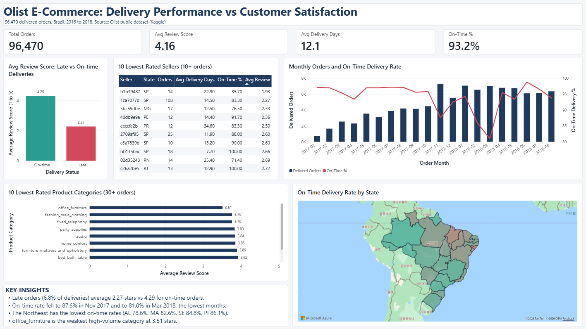

# Olist E-Commerce: Delivery Performance vs Customer Satisfaction

An end-to-end analysis of the [Brazilian E-Commerce Public Dataset by Olist](https://www.kaggle.com/datasets/olistbr/brazilian-ecommerce) (~100k orders, 2016–2018), built with PostgreSQL and Power BI.

**Business question:** Does delivery performance affect customer satisfaction, and where is that risk concentrated?



## Key findings

| Metric | Value |
|---|---|
| Delivered orders analysed | 96,470 |
| On-time delivery rate | ~93.2% |
| Average delivery time | ~12.1 days |
| Avg review score, on-time orders | **~4.29** |
| Avg review score, late orders | **~2.27** |

- Late deliveries go with much lower reviews: late orders (6.8% of delivered orders) score about 2 points lower on a 5-point scale. This is a correlation, not proof of causation.
- Risk is concentrated in the Northeast. The lowest on-time rates are AL (78.6%), MA (82.6%), SE (84.8%) and PI (86.1%).
- Meeting the promised date matters more than raw speed: AP and AM have the longest delivery times (26 to 27 days) but about 97% on-time and 4.24 stars.
- `office_furniture` is the weakest high-volume category, averaging 3.51 stars across 1,254 orders (the next lowest category scores 3.76).
- Some sellers have very low scores (below 2.5 among sellers with 10+ orders). For some of them poor on-time rates explain it, for others they do not, which points to product or service issues that this data cannot confirm.

## Project structure

```
├── data/               # Raw Olist CSVs (not committed, download from Kaggle)
├── sql/
│   ├── 00_drop_tables.sql        # Drop all tables for a clean rebuild
│   ├── 01_create_tables.sql      # Schema for the 9 source tables
│   ├── 02_import_data.sql        # Bulk-load CSVs with psql \copy
│   ├── 03_data_validation.sql    # Row counts, orphans, nulls, duplicates
│   ├── 04_transformations.sql    # Reference-data fix + 5 analysis views
│   ├── 05_export_for_powerbi.sql # Export views to CSV for Power BI
│   └── run_all.sql               # Runs 00–04 in order, stops on first error
├── powerbi_export/     # Generated CSVs (not committed)
└── dashboard/          # Power BI report
```

## Getting started

### Prerequisites
- PostgreSQL (tested with 18) with the `psql` client
- Power BI Desktop (Windows) for the dashboard

### 1. Get the data
Download the dataset from [Kaggle](https://www.kaggle.com/datasets/olistbr/brazilian-ecommerce) and put the 9 CSV files in `data/`.

### 2. Build the database
```bash
createdb -U postgres olist_ecommerce

cd sql
psql -U postgres -d olist_ecommerce -f run_all.sql
```
Run from the `sql/` folder: the default data path is `../data`, relative to where `psql` is run. To use a different location:
```bash
psql -U postgres -d olist_ecommerce -v datadir='/path/to/data' -f run_all.sql
```
> ⚠️ `run_all.sql` drops and recreates all tables and views.

### 3. Export for Power BI
```bash
psql -U postgres -d olist_ecommerce -f 05_export_for_powerbi.sql
```
This writes 5 CSVs to `../powerbi_export` (override with `-v outdir='/path'`). Then load them into Power BI Desktop (Get data > Text/CSV).

## Analysis views

| View | Grain | Purpose |
|---|---|---|
| `v_order_delivery_reviews` | One row per delivered order | Core fact table: delivery days, days vs estimate, on-time flag, review score |
| `v_monthly_delivery_trend` | Month | Order volume, delivery time, on-time % and review score over time |
| `v_state_performance` | Customer state | Where delivery risk is concentrated geographically |
| `v_category_performance` | Product category (English) | Categories with low satisfaction |
| `v_seller_performance` | Seller | Underperforming sellers |

## Data quality notes
Findings from `03_data_validation.sql`, and how they were handled:
- **Missing category translations:** 2 categories (13 products) had no English name. These are added in `04_transformations.sql` so the fix is part of the pipeline.
- **Multiple reviews per order:** 547 orders have 2–3 reviews. The views keep only the most recent review, so each order is counted once.
- **Orders without a delivery date:** 2,965 orders have no delivery date (mostly shipped, canceled or unavailable, but 8 are marked delivered). Delivered orders are analysed only when they have a date, so the main view has 96,470 rows.
- **Date-only delivery estimates:** estimated dates have no time component, so lateness is judged by calendar date. Comparing timestamps would wrongly flag about 1,300 on-day arrivals as late.
- **Sparse early data:** Sep to Dec 2016 has almost no orders, so the monthly trend starts in Jan 2017.
- **Missing product data:** 610 products have no category and 2 have no weight.
- No orphaned product or seller references, duplicate order items, or invalid prices were found.

## Limitations
- Correlation, not causation. Product quality and other factors also affect reviews.
- Category and seller averages are weighted per order item. Categories need 30+ orders and sellers 10+ orders to be ranked.

## Tech stack
PostgreSQL · psql · Power BI · DAX

## Data source and author
Data: [Olist Brazilian E-Commerce Public Dataset](https://www.kaggle.com/datasets/olistbr/brazilian-ecommerce) on Kaggle (check its licence before reuse).

Author: Subin Seol
